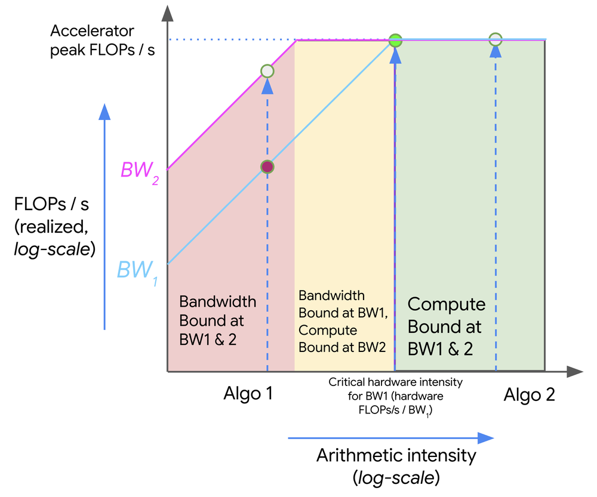

# Writing blog posts

Posts are clear, concise, and easy to read, like the owner's study notes: facts, mechanisms, formulas, worked numbers, and figures from the original sources. The owner supplies every opinion and every personal experience.

The style model is [Lilian Weng's blog](https://lilianweng.github.io/): intuition first, connected prose, and papers cited by author. Match its structure, and keep the owner's shorter length, worked numbers, and pseudocode.

The goal is a better reading experience. Treat the style guidance below as judgment calls that serve the reader, and choose what reads best in each passage. Accuracy, credit, and the rules on opinions stay firm, because readers rely on them.

## Ask first

Before drafting, ask the owner if any of these is missing:
- Facts only the owner has: what they did, measured, or learned.
- An opinion or recommendation the post needs.
- The topics to cover, when the request doesn't name them.

Ask with the question tool, or in your final message if you have no way to ask. In that case, stop and send only the questions, with no draft, outline, or fill-in template. Ask again whenever a new doubt comes up while writing.

A request that names the topics and says to use online resources has what it needs, so start writing.

## Post shape

1. File: `_posts/YYYY-MM-DD-Title-With-Hyphens.md`.
2. Front matter: `layout: post`, `comments: true`, `mathjax: true` if there is math, `title` in title case, `excerpt`, `date`. Use today's date unless the owner gives one.
3. Opening: a short, plain introduction that defines the topic, says why it matters, and states what the post covers.
4. Body: sentence-case headings, numbered (`## 1. Background`, `### 1.1 Metrics`) when a post is long enough that readers need to navigate it. Put background first.
5. Explain each idea in the order that's easiest to follow, usually intuition or an analogy, what it is, the formula or pseudocode, then a worked example with real numbers.
6. Ending: end on the last topic instead of a generic Conclusion. The last topic can be a practical one, such as diagnosing a real system.
7. `## References`: a numbered list of the papers and blogs used, as `1. Author et al. "[Full title](link)." Venue Year.`

In the text, cite papers by author and year with a link, as in `PagedAttention ([Kwon et al. 2023](link))`. For a blog or doc with no clear author, link its name.

Link to the owner's earlier posts with `` instead of repeating them.

## Sentences

Explain in connected prose, and use bullets where readers benefit from a list, such as categories or steps.

Help readers see why each section is there, usually by saying what problem it addresses and how it relates to the previous one. Keep sentences that teach the reader something, and cut ones that only repeat or sum up the text around them.

Define each term when it first appears, and bold key terms where they're defined.

Name the model, hardware, and baseline next to any reported result. Read each claim in its source. If you can't reach the source, tell the owner which claims rest on secondary sources.

## First person

Write "I" only for an opinion the owner gave you, or for a neutral link such as "see my earlier post". Recommendations, rules of thumb, and "which one to use" advice are opinions, so ask the owner for them. Without an answer, leave them out and report the published facts instead.

## Tables

Use a table when it makes a comparison easier to read than prose would. Otherwise use prose or bullets.

## Figures

Every figure comes from the owner's folder, an online blog, or a paper. Never draw one, which rules out matplotlib, Mermaid, SVG, and ASCII diagrams, even when a chart is requested.

If no sourced figure shows what the post needs, ask the owner before using a different figure.

1. Save it in `images/post_YYYY_MM_DD_topic/`, using the post's date.
2. Crop paper figures from the PDF, leaving out the caption and page text.
3. Look at the image, then write its caption from what it shows.
4. Credit it in an italic line right below the image:

```

*What it shows. Source: [Name](https://link)*
```

Don't ask whether sourced figures are okay. They are. Tell the owner if the source states no license.

## Red flags

Delete these and rewrite the sentence as a plain fact:
- Invented voice: "My rule of thumb", "I'd use", "I wouldn't start here", "I recommend".
- Framing: "has a catch", "the price is", "worth knowing", "the cheapest win", "a more honest number", "answers one question", "make this concrete", "matters less than the name suggests".
- Wrap-ups: a last sentence that restates the paragraph, or a line saying why the post's ideas matter.

## Finish

1. Run the `unslop` skill on all new text, and skip its "Adding soul" section.
2. Run `jekyll build` and check that images load and math renders.
3. Cross-check everything the post states before calling it ready to publish:
   - Open the source of every claim, number, attribution, and link, and confirm it says exactly that.
   - Use datasheets, papers, and official docs for specs and results.
   - Recompute every calculated number, and everything built on a number that changed.
   - Confirm that numbers used together describe the same hardware variant, model, and settings.
   - Cut anything you can't confirm, or ask the owner about it.
4. Tell the owner what you checked, which numbers you calculated yourself, and which claims you couldn't confirm.
5. Leave everything uncommitted unless the owner asks.
