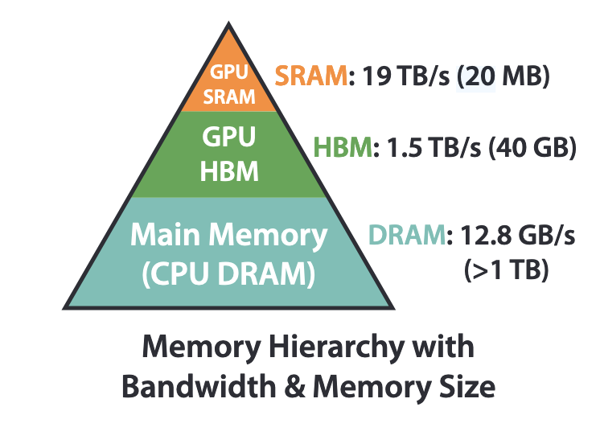
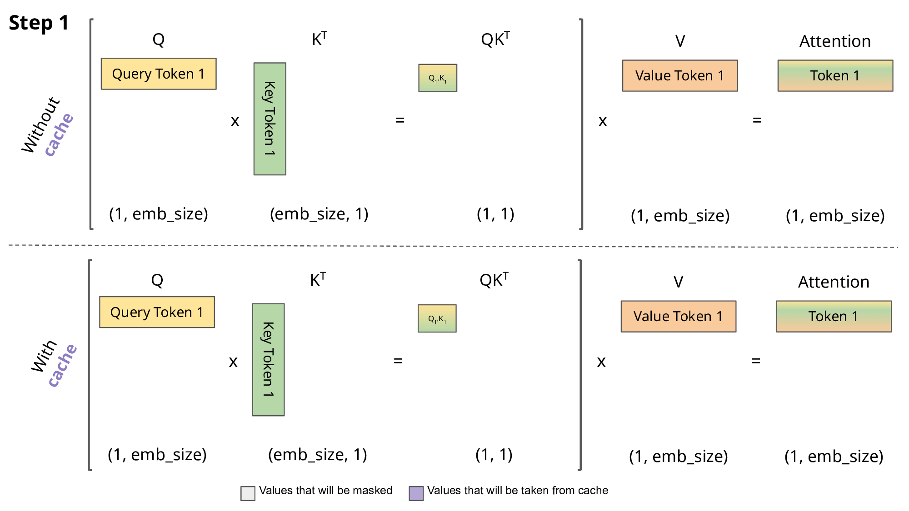
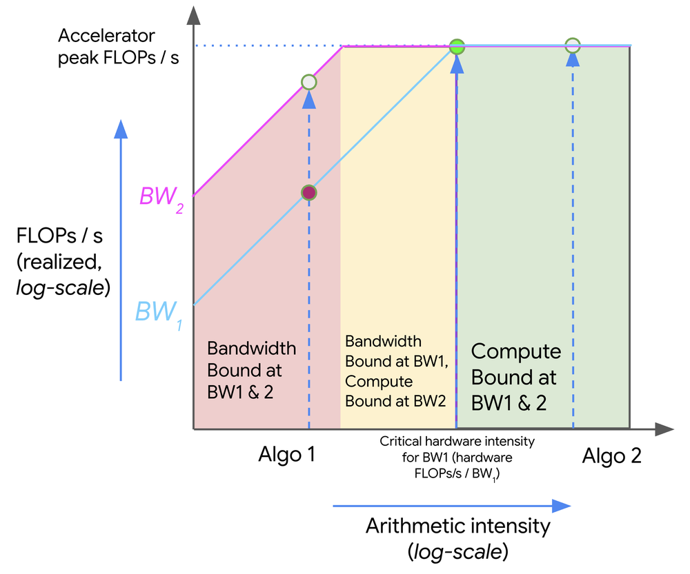
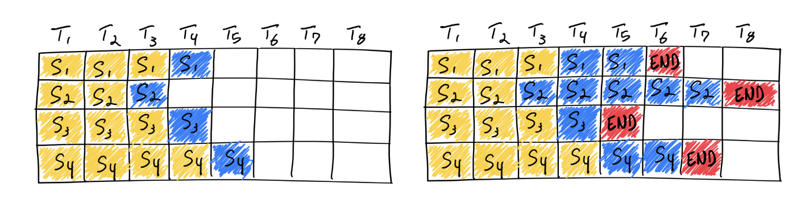
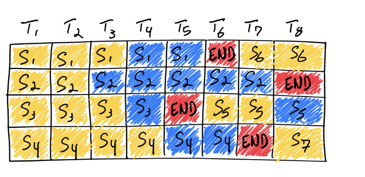
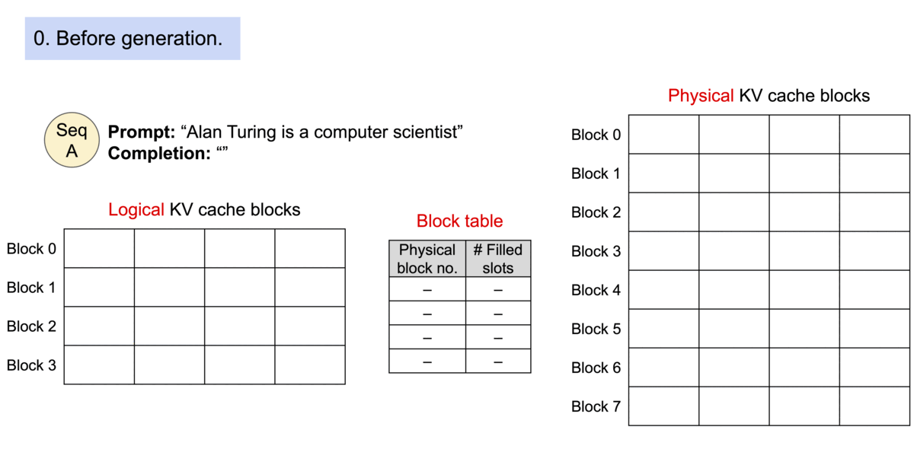
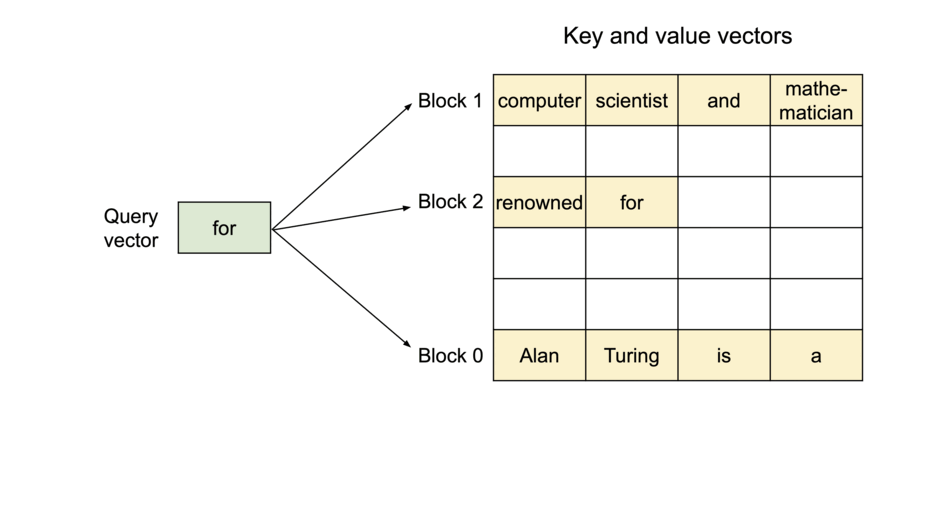
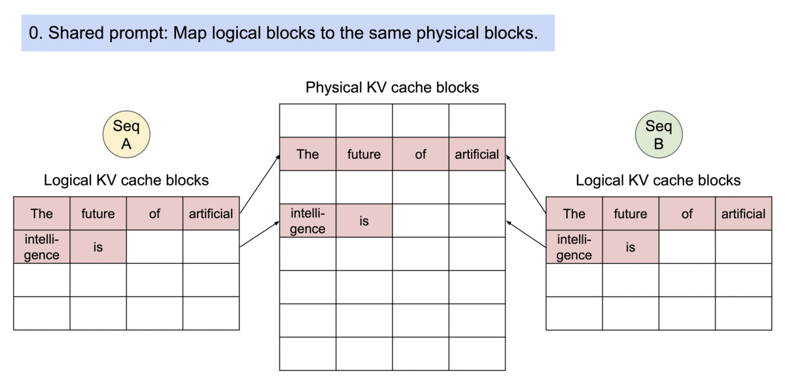
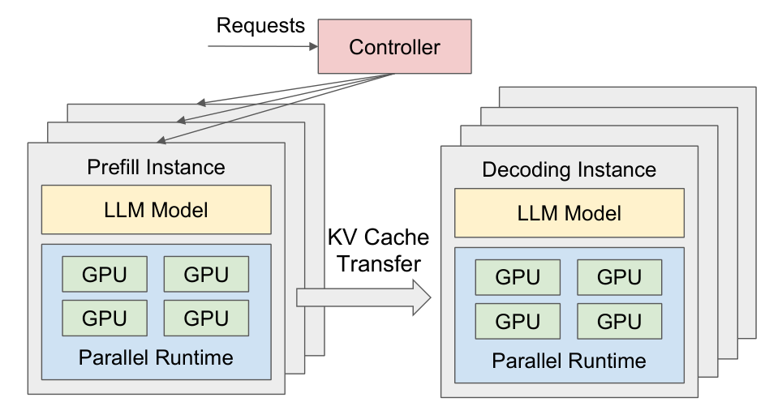
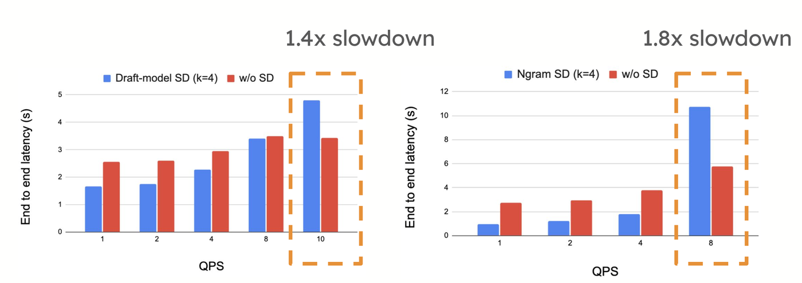

**LLM inference** generates text from a trained language model, one token at a time. It differs from serving a typical model because a request runs once for the prompt and then once per output token, nobody knows in advance how long it will run, and it holds GPU memory that grows with every token. This post reviews how serving systems handle these problems, covering the KV cache, continuous batching, PagedAttention, prefix caching, disaggregated serving, and speculative decoding.


## 1. Background
The techniques in this post depend on how a request runs, how latency is measured, and how GPU memory is laid out.

### 1.1 Prefill and decode
Answering a question has two parts, reading the question and then replying word by word, and a request works the same way. **Prefill** processes the whole prompt in one forward pass and produces the first output token. **Decode** then generates the remaining tokens one at a time. Prefill sets the time to first token and is usually limited by compute. Decode sets the streaming speed and is limited by memory bandwidth and capacity.

### 1.2 Metrics
These two phases reach the user as two kinds of waiting, before the first token and between tokens. Serving systems measure them with the following metrics:

* **TTFT** (time to first token) runs from arrival to the first output token, so it includes queueing and prefill.
* **TPOT** (time per output token) is the average time per token after the first.
* **ITL** (inter-token latency) is the gap between two consecutive tokens. TPOT is its average, but users notice the tail, as a stutter in the stream.
* End-to-end latency is $\text{TTFT} + \text{TPOT} \times (N - 1)$ for $N$ output tokens.
* Throughput counts tokens or requests per second.
* **Goodput** is the highest request rate a system can serve while a set share of requests, such as 90%, meets the TTFT and TPOT targets ([Zhong et al. 2024](https://arxiv.org/abs/2401.09670)).

Throughput and latency pull against each other, because a bigger batch produces more tokens per second but each step takes longer. Goodput captures both, so it's usually the number to optimize.

### 1.3 GPU memory hierarchy
Both phases spend much of their time reading data, and their speed depends on where that data lives. A GPU has a small, fast memory next to compute and larger, slower memory further away.


*Memory hierarchy with numbers for a 40 GB A100. Source: Figure 1 of [Dao et al. 2022](https://arxiv.org/abs/2205.14135)*

**HBM** (high bandwidth memory) is about 100x faster than the link to CPU memory, but it's small.


## 2. KV cache
Decode repeats one step per token, so the first problem is removing the repeated work inside that step.

A decode step only needs one new token, yet a plain forward pass recomputes the whole sequence. In a causal Transformer, adding a new token does not change the representations of earlier tokens, so the keys and values of past tokens can be stored and reused. This store is the **KV cache**.


*KV cache, step by step. Purple cells come from the cache. Source: [Lages 2023](https://medium.com/@joaolages/kv-caching-explained-276520203249)*

To see what this saves, count the dot products between queries and keys. Without the cache, step $t$ reruns all $t$ positions, so $QK^\top$ is $(t, t)$ and costs $t^2$. With the cache, only the newest token runs, so $QK^\top$ is $(1, t)$ and costs $t$. Summing over $T$ steps gives:

$$
\underbrace{\sum_{t=1}^{T} t^2 \approx \frac{T^3}{3}}_{\text{without cache}}
\qquad
\underbrace{\sum_{t=1}^{T} t \approx \frac{T^2}{2}}_{\text{with cache}}
$$

So the attention work drops from $O(T^3)$ to $O(T^2)$. For $T = 1000$, that's about 334 million dot products against 500 thousand.

Prefill builds the cache, and each decode step appends to it. Each new query still reads every cached key and value.

### 2.1 How big is it?
The KV cache trades compute for memory, and its size grows with every token. For one sequence:

$$
M_{KV} = 2 \cdot L \cdot T \cdot H_{KV} \cdot D_h \cdot b
$$

where the 2 counts K and V, $L$ is the number of layers, $T$ the number of cached tokens, $H_{KV}$ the number of KV heads, $D_h$ the head dimension, and $b$ the bytes per element.

For example, OPT-13B has 40 layers, $H_{KV} D_h = 5120$, and uses FP16. That gives $2 \cdot 40 \cdot 5120 \cdot 2 \approx 0.8$ MB per token ([Kwon et al. 2023](https://arxiv.org/abs/2309.06180)).

The [Understanding KV Cache](https://x.com/techNmak) handbook uses an illustrative model with $L = 32$, $D_h = 128$, $b = 2$, and 32 query heads. At 32K tokens, its cache takes 16 GiB with multi-head attention ($H_{KV} = 32$), 4 GiB with grouped-query attention ($H_{KV} = 8$), and 0.5 GiB with multi-query attention ($H_{KV} = 1$).

Model weights are a fixed cost. The KV cache is per request, so long context limits how many requests a GPU can hold at once.

### 2.2 Why prefill is compute-bound and decode is memory-bound
The KV cache also explains why the two phases hit different limits.

Think of a GPU as a kitchen, where the cooks are compute and a delivery truck brings ingredients from memory. If one delivery feeds many dishes, the cooks set the pace. If every dish needs its own delivery, the truck sets the pace. In prefill, one load of the weights serves every prompt token. In decode, each step loads the weights again for one token per sequence, plus each sequence's KV cache.

The roofline model ([Williams et al. 2008](https://www2.eecs.berkeley.edu/Pubs/TechRpts/2008/EECS-2008-134.html)) makes this precise. Define the **arithmetic intensity** $I$ as FLOPs per byte moved to or from memory. Then:

$$
\text{attainable FLOPs/s} = \min(\text{peak FLOPs/s},\ I \times \text{memory bandwidth})
$$

The two limits meet at the **ridge**, where $I$ equals peak FLOPs/s divided by memory bandwidth. A 40 GB A100 does [312 TFLOPS in FP16 and 1,555 GB/s from HBM](https://www.nvidia.com/content/dam/en-zz/Solutions/Data-Center/a100/pdf/nvidia-a100-datasheet-us-nvidia-1758950-r4-web.pdf), so its ridge is at about 200 FLOPs per byte. Below that a workload is memory-bound, and above it a workload is compute-bound.


*A roofline plot for two bandwidths. The ridge is the critical hardware intensity. Source: [Austin et al. 2025](https://jax-ml.github.io/scaling-book/roofline/)*

To estimate $I$, count what each loaded byte does. In FP16, a weight does one multiply and one add per token, which is 2 FLOPs for 2 bytes. Cached keys and values work out the same. So each byte gives about 1 FLOP per token that uses it, and $I$ is roughly how many tokens share each byte.

For a model with $P$ parameters, the weights take $2P$ bytes and one token costs $2P$ FLOPs. With a prompt of $T$ tokens, or a batch of $B$ sequences:

$$
I_{\text{prefill}} \approx \frac{2P \cdot T}{2P + M_{KV}}
\qquad
I_{\text{decode}} \approx \frac{2P \cdot B}{2P + B \cdot M_{KV}}
$$

Prefill loads the weights once and applies them to all $T$ tokens. Decode shares the weights across the batch, but every sequence reads its own KV cache.

Here are the numbers for [Llama 2 7B](https://huggingface.co/docs/transformers/main/model_doc/llama) on the same GPU, with 14 GB of weights and about 1 GB of KV cache for 2,000 tokens:

| Step | $I$ | Math time | Memory time |
| --- | --- | --- | --- |
| Decode, batch 1 | 0.9 | 0.04 ms | 9.7 ms |
| Decode, batch 32 | 9.4 | 1.4 ms | 31 ms |
| Prefill, 100 tokens | 100 | 4.5 ms | 9.0 ms |
| Prefill, 2,000 tokens | 1,860 | 90 ms | 9.7 ms |

A 2,000-token prefill sits far past the ridge. It spends 90 ms on math and 9.7 ms on memory, so more FLOPs would help and more bandwidth wouldn't. Decode is the opposite, spending over 20x longer on memory than on math.

Batching moves decode to the right, but it can't reach the ridge. As $B$ grows, $I_{\text{decode}}$ approaches $2P / M_{KV}$, which is about 13 here, because every extra sequence brings its own cache. Longer context lowers that ceiling and a smaller cache raises it. Grouped-query attention with 8 KV heads gets to about 53, so the techniques in Section 2.3 help speed as well as capacity.

Prefill isn't always compute-bound. Below about 200 tokens, each weight load isn't shared by enough tokens to reach the ridge.

These numbers are upper bounds on speed. The model assumes weights load once per step and kernels reach peak FLOPs, and it ignores intermediate activations, SRAM, and attention FLOPs (under 10% here).

### 2.3 Making the cache smaller
Since every sequence brings its own cache, a smaller cache helps both capacity and speed. The most direct way is to store fewer KV heads. **MQA** (multi-query attention; [Shazeer 2019](https://arxiv.org/abs/1911.02150)) makes all query heads share one KV head, so $H_{KV} = 1$. **GQA** (grouped-query attention; [Ainslie et al. 2023](https://arxiv.org/abs/2305.13245)) makes groups of query heads share KV heads, so $1 < H_{KV} < H_Q$. **MLA** (multi-head latent attention; [DeepSeek-AI 2024](https://arxiv.org/abs/2405.04434)) stores a low-rank latent instead of K and V, and DeepSeek-V2 reports a KV cache 93.3% smaller than DeepSeek 67B's.

All three are chosen at training time. **KV quantization** instead stores K and V in lower precision, e.g. [FP8](https://docs.vllm.ai/en/stable/features/quantization/quantized_kvcache/). It's lossy, but it can be applied at serving time.


## 3. Continuous batching
The KV cache makes one sequence cheaper to run, and batching shares a GPU across many sequences.

### 3.1 Static batching
**Static batching** works like a bus that takes no new passengers until everyone has got off. Sequences finish at different times, but the batch runs until the longest one ends, so finished slots sit idle while new requests wait in the queue.


*Yellow is prompt, blue is generated, red is end of sequence. Source: [Daniel et al. 2023](https://www.anyscale.com/blog/continuous-batching-llm-inference)*

### 3.2 Iteration-level scheduling
**Continuous batching** lets passengers on and off at every stop. Orca ([Yu et al. 2022](https://www.usenix.org/conference/osdi22/presentation/yu)) schedules per iteration instead of per batch, so after every step, finished sequences leave and waiting requests join.


*S5, S6 and S7 take the slots freed by finished sequences. Source: [Daniel et al. 2023](https://www.anyscale.com/blog/continuous-batching-llm-inference)*

```
while True:
    batch.remove_finished()     # return results, free their KV cache
    batch.admit_waiting()       # new requests join
    model.step(batch)           # one token for each sequence
```

[Daniel et al. (2023)](https://www.anyscale.com/blog/continuous-batching-llm-inference) report up to 23x throughput for vLLM with its memory optimizations against naive static batching, for OPT-13B on one 40 GB A100.

### 3.3 Prefill stalls decode
Admitting requests at every step creates a new problem, because each new request brings its prefill into a running batch. A prefill step is much slower than a decode step, so when a long prompt joins, every running sequence waits for it and ITL spikes.

Sarathi-Serve ([Agrawal et al. 2024](https://arxiv.org/abs/2403.02310)) replaces one long pause with many short ones. **Chunked prefill** splits a prompt into near-equal chunks and adds one chunk per step alongside the running decodes:

```
while True:
    batch = running_decodes + next_prefill_chunk(token_budget)
    model.step(batch)
```

Every step now takes about the same time and decodes never stall. In exchange, a long prompt takes several steps, which can raise TTFT. Agrawal et al. report 2.6x higher serving capacity than vLLM for Mistral-7B on one A100 under tail latency constraints.


## 4. PagedAttention
Continuous batching changes the batch at every step, so KV cache memory has to be allocated and freed as sequences come and go.

### 4.1 The problem
The output length is unknown, so the cache size is too. Allocating a contiguous tensor for the maximum length wastes memory in two ways. Some slots are reserved and never used, and the free gaps left behind can be too small to fit a new request. [Kwon et al. (2023)](https://arxiv.org/abs/2309.06180) found that only 20.4%-38.2% of KV cache memory held actual token states in existing systems.

### 4.2 Blocks and the block table
Operating systems solved a similar problem with virtual memory, where a process sees continuous memory while its pages sit anywhere. **PagedAttention** ([Kwon et al. 2023](https://arxiv.org/abs/2309.06180)) applies the same idea, with blocks as pages, tokens as bytes, and requests as processes. The KV cache is split into fixed-size blocks that don't need to be contiguous, and a block table maps logical blocks to physical ones.


*Blocks are allocated on demand as tokens are generated. Source: [Kwon et al. 2023](https://vllm.ai/blog/2023-06-20-vllm)*

Only the last block of a sequence can have empty slots, which brings waste under 4%. The attention kernel reads the blocks one by one:


*Attention runs across blocks that are scattered in memory. Source: [Kwon et al. 2023](https://vllm.ai/blog/2023-06-20-vllm)*

### 4.3 Sharing and copy-on-write
Blocks also let sequences share memory. Sequences from the same prompt, as in parallel sampling and beam search, can point to the same physical blocks. Each block has a reference count, and a sequence that writes to a shared block copies it first.


*Two outputs share the prompt's blocks until they diverge. Source: [Kwon et al. 2023](https://vllm.ai/blog/2023-06-20-vllm)*

### 4.4 Running out of blocks
Blocks can still run out, because a request's final size isn't known when it's admitted. When memory is full, vLLM preempts the newest requests first. It evicts all of a sequence's blocks or none of them, because they're always read together.

The paper brings evicted state back in one of two ways. Swapping copies the blocks to CPU RAM and back. Recomputation drops them and runs the prompt plus the generated tokens as one new prefill. Which is faster depends on the CPU-GPU bandwidth and the GPU's compute. [Current vLLM](https://github.com/vllm-project/vllm/blob/main/vllm/v1/core/sched/scheduler.py) only recomputes.

vLLM's default block size is 16 tokens. Smaller blocks can't fully use the GPU's parallelism when reading the cache, and larger blocks bring internal fragmentation back.

Across various models and workloads, Kwon et al. report 2-4x higher throughput than FasterTransformer and Orca at the same latency.


## 5. Prefix caching
The KV cache reuses state within a request, and **prefix caching** reuses it across requests. Many requests to a service begin with the same system prompt, so a server can repeat the same prefill work. If a new prompt starts with tokens the server has already processed, it can skip that part of prefill.

[vLLM](https://docs.vllm.ai/en/stable/design/prefix_caching.html) builds this on the block table. Each full block gets a hash that depends on everything before it:

```
block_hash = hash((parent_hash, block_tokens, extra_hashes))
```

Including the parent hash means two blocks match only if their whole prefix matches. `extra_hashes` covers anything else that changes the result, such as LoRA IDs and image inputs. Blocks with a reference count of 0 stay in the cache until they're evicted in LRU order.

Prefix caching only helps prefill. New tokens are decoded as usual, so a long output sees little benefit. It also needs an exact token match, so static content such as the system prompt and tools has to come first, and variable content last. A timestamp at the top of the prompt misses the cache every time.

Sharing a cache can leak information. In a multi-tenant service, a fast response reveals that someone already sent that prefix, so vLLM's per-request `cache_salt` limits sharing to requests with the same salt.

Offloading reusable blocks to CPU RAM or disk gives a bigger cache, but it only helps when transferring a block is cheaper than recomputing it.


## 6. Disaggregated prefill and decode
Chunked prefill reduces how much the two phases interfere on one GPU, and **disaggregation** removes that interference by running them on separate workers.


*Prefill and decoding instances with KV cache transfer between them. Source: Figure 6 of [Zhong et al. 2024](https://arxiv.org/abs/2401.09670)*

A request moves through the system in four steps:

1. A controller sends the request to a prefill worker.
2. The prefill worker builds the KV cache and returns the first token.
3. The KV cache moves to a decode worker.
4. The decode worker streams the remaining tokens.

Long prefills can no longer stall decodes. Each pool can also use different hardware, since prefill wants compute and decode wants memory bandwidth and capacity, and each can be scaled for its own latency target.

Three systems explore this design. Splitwise ([Patel et al. 2023](https://arxiv.org/abs/2311.18677)) splits the phases across machines and tunes hardware for each, reporting up to 1.4x throughput at 20% lower cost. DistServe ([Zhong et al. 2024](https://arxiv.org/abs/2401.09670)) chooses resources and parallelism per phase under TTFT and TPOT targets, reporting 7.4x more requests or a 12.6x tighter SLO. Mooncake ([Qin et al. 2024](https://arxiv.org/abs/2407.00079)) adds a shared KV cache across CPU, DRAM and SSD. It serves Kimi and reports 75% more requests on real workloads. These results use different baselines, so don't compare them directly.

The main cost is moving the cache. Sending 1 GiB over a 200 Gb/s link takes about 43 ms, and that delay lands between the first and second token, so long prompts need fast networks. The right ratio of prefill to decode workers also shifts with the workload, and there are more components that can fail.

vLLM hands the cache over through [connectors](https://docs.vllm.ai/en/stable/features/disagg_prefill/) such as NIXL and Mooncake, and [NVIDIA Dynamo](https://github.com/ai-dynamo/dynamo) adds routing and tiered caching on top.


## 7. Speculative decoding
Even with these systems, decode produces one token per pass. At batch 1, a decode step in Section 2.2 takes 9.7 ms to load data and 0.04 ms to do the math, so the GPU's compute sits mostly idle.

**Speculative decoding** ([Leviathan et al. 2023](https://arxiv.org/abs/2211.17192)) uses that spare compute. Think of a junior writer who drafts the next few words and a senior editor who checks them all in one read. A cheap proposer drafts several tokens, and the target model verifies them in one pass. See [my earlier post]() for the sampling math.

```
while not finished:
    draft = propose(tokens, gamma)              # gamma cheap guesses
    probs = target_model.step(tokens + draft)   # verify all in one pass
    tokens += accept_prefix(draft, probs)       # plus one corrected token
```

Rejected tokens are rolled back, including their KV cache entries. Sampling this way keeps the target model's output distribution, so quality doesn't change. [vLLM's docs](https://docs.vllm.ai/en/stable/features/speculative_decoding/) call its sampling lossless up to the precision limits of hardware numerics.

### 7.1 Why one pass can check many tokens
A pass loads the weights and the KV cache once, whether it processes 1 or 5 tokens per sequence. So speculation raises the arithmetic intensity without adding much memory traffic.

In the Llama 2 7B example, going from 1 to 5 tokens per sequence moves math time from 0.04 ms to 0.22 ms at batch 1, and from 1.4 ms to 7.2 ms at batch 32. Memory time stays at 9.7 ms and 31 ms, so a pass that checks 5 tokens costs about the same as a pass that checks 1. The ceiling from Section 2.2 also rises from about 13 to about 67, because each KV byte is now shared by 5 tokens instead of 1.

### 7.2 Expected speedup
The gain depends on how many drafted tokens survive. Let $\alpha$ be the acceptance rate, $\gamma$ the number of drafted tokens, and $c$ the cost of a draft step relative to a target step. Then:

$$
\mathbb{E}[\text{tokens per pass}] = \frac{1 - \alpha^{\gamma + 1}}{1 - \alpha}
\qquad
\text{speedup} = \frac{1 - \alpha^{\gamma + 1}}{(1 - \alpha)(\gamma c + 1)}
$$

With $\gamma = 4$ and $c = 0.05$, that's 2.8x at $\alpha = 0.8$ and 1.9x at $\alpha = 0.6$. The formula assumes verification costs the same as one normal pass, which is why it fits memory-bound decode.

### 7.3 Where drafts come from
Acceptance rate and draft cost both depend on the proposer. A draft model is a small model that generates the tokens, and it needs its own compute and KV cache. N-gram lookup copies matching text from the prompt, which costs almost nothing and suits summarization and Q&A, but it's weak on open-ended generation. Extra heads, as in EAGLE ([Li et al. 2024](https://arxiv.org/abs/2401.15077)), are layers added to the target model. They're light and reach high acceptance, but need training for each model.

### 7.4 Speculation under load
The spare compute behind speculation runs out as traffic grows. At $\alpha = 0.8$, $\gamma = 5$, and with free drafts ($c = 0$), Leviathan et al. show 1.63x more operations for 3.69x more speed. Under load, that extra work and the rejected tokens take capacity from other requests.

The [vLLM Team (2024)](https://vllm.ai/blog/2024-10-17-spec-decode) measured this for Llama 3 70B on 4x H100. On CNN/DailyMail with n-grams, speculation was 2.8x faster at QPS=1 and 1.8x slower at QPS=8.


*Latency with and without speculation on 4x H100. Left is ShareGPT with a draft model, right is CNN/DailyMail with n-grams. Source: [vLLM Team 2024](https://vllm.ai/blog/2024-10-17-spec-decode)*

TurboSpec ([Liu et al. 2024](https://arxiv.org/abs/2406.14066)) tunes the amount of speculation at runtime to avoid this.


## 8. Other techniques
Beyond the main techniques above, several others target routing, model size, attention speed, parallelism, and scheduling:

* Cache-aware routing balances cache overlap against load, because a prefix cache only helps if the request reaches the worker that holds it.
* Weight quantization to 4 bits ([Lin et al. 2024](https://arxiv.org/abs/2306.00978)) fits a larger model on one GPU, with some quality loss.
* Better attention kernels help both phases. [FlashAttention]() reduces HBM access in prefill, and Flash-Decoding ([Dao et al. 2023](https://pytorch.org/blog/flash-decoding/)) parallelizes over the cached keys and values for long-context decode.
* Tensor parallelism splits each layer across GPUs to reduce step latency. Pipeline parallelism places layers on different GPUs to increase throughput, but a single request gets no faster.
* First-come-first-served scheduling lets long requests block short ones. FastServe ([Wu et al. 2023](https://arxiv.org/abs/2305.05920)) preempts at the token level to avoid this, and Mooncake rejects requests early under overload when it predicts no decoding slots will be free.


## 9. Diagnosing a real system
Each technique above maps to a metric from Section 1.2, so diagnosis starts from the metric that's failing. Slow TTFT points to queueing or prefill, so check the prefix cache hit rate and prefill capacity. Slow TPOT points to memory bandwidth or batch size. ITL spikes point to prefill stalling decode.


## References
1. Zhong et al. "[DistServe: Disaggregating Prefill and Decoding for Goodput-optimized Large Language Model Serving](https://arxiv.org/abs/2401.09670)." OSDI 2024.
2. Dao et al. "[FlashAttention: Fast and Memory-Efficient Exact Attention with IO-Awareness](https://arxiv.org/abs/2205.14135)." arXiv 2022.
3. Lages. "[KV Caching Explained](https://medium.com/@joaolages/kv-caching-explained-276520203249)." Medium 2023.
4. Kwon et al. "[Efficient Memory Management for Large Language Model Serving with PagedAttention](https://arxiv.org/abs/2309.06180)." SOSP 2023.
5. @techNmak. "[Understanding KV Cache](https://x.com/techNmak)." Handbook 02, Understanding AI Series.
6. Williams et al. "[Roofline: An Insightful Visual Performance Model for Floating-Point Programs and Multicore Architectures](https://www2.eecs.berkeley.edu/Pubs/TechRpts/2008/EECS-2008-134.html)." UC Berkeley Technical Report 2008.
7. NVIDIA. "[NVIDIA A100 Tensor Core GPU](https://www.nvidia.com/content/dam/en-zz/Solutions/Data-Center/a100/pdf/nvidia-a100-datasheet-us-nvidia-1758950-r4-web.pdf)." Datasheet.
8. Austin et al. "[How To Scale Your Model: All About Rooflines](https://jax-ml.github.io/scaling-book/roofline/)." Google DeepMind 2025.
9. Austin et al. "[How To Scale Your Model: All About Transformer Inference](https://jax-ml.github.io/scaling-book/inference/)." Google DeepMind 2025.
10. Shazeer. "[Fast Transformer Decoding: One Write-Head is All You Need](https://arxiv.org/abs/1911.02150)." arXiv 2019.
11. Ainslie et al. "[GQA: Training Generalized Multi-Query Transformer Models from Multi-Head Checkpoints](https://arxiv.org/abs/2305.13245)." EMNLP 2023.
12. DeepSeek-AI. "[DeepSeek-V2: A Strong, Economical, and Efficient Mixture-of-Experts Language Model](https://arxiv.org/abs/2405.04434)." arXiv 2024.
13. vLLM. "[Quantized KV Cache](https://docs.vllm.ai/en/stable/features/quantization/quantized_kvcache/)." vLLM Documentation.
14. Daniel et al. "[How continuous batching enables 23x throughput in LLM inference while reducing p50 latency](https://www.anyscale.com/blog/continuous-batching-llm-inference)." Anyscale Blog 2023.
15. Yu et al. "[Orca: A Distributed Serving System for Transformer-Based Generative Models](https://www.usenix.org/conference/osdi22/presentation/yu)." OSDI 2022.
16. Agrawal et al. "[Taming Throughput-Latency Tradeoff in LLM Inference with Sarathi-Serve](https://arxiv.org/abs/2403.02310)." arXiv 2024.
17. Kwon et al. "[vLLM: Easy, Fast, and Cheap LLM Serving with PagedAttention](https://vllm.ai/blog/2023-06-20-vllm)." vLLM Blog 2023.
18. vLLM. "[Automatic Prefix Caching](https://docs.vllm.ai/en/stable/design/prefix_caching.html)." vLLM Documentation.
19. Patel et al. "[Splitwise: Efficient Generative LLM Inference Using Phase Splitting](https://arxiv.org/abs/2311.18677)." arXiv 2023.
20. Qin et al. "[Mooncake: A KVCache-centric Disaggregated Architecture for LLM Serving](https://arxiv.org/abs/2407.00079)." arXiv 2024.
21. vLLM. "[Disaggregated Prefilling](https://docs.vllm.ai/en/stable/features/disagg_prefill/)." vLLM Documentation.
22. NVIDIA. "[Dynamo](https://github.com/ai-dynamo/dynamo)." GitHub.
23. Leviathan et al. "[Fast Inference from Transformers via Speculative Decoding](https://arxiv.org/abs/2211.17192)." ICML 2023.
24. vLLM. "[Speculative Decoding](https://docs.vllm.ai/en/stable/features/speculative_decoding/)." vLLM Documentation.
25. Li et al. "[EAGLE: Speculative Sampling Requires Rethinking Feature Uncertainty](https://arxiv.org/abs/2401.15077)." arXiv 2024.
26. vLLM Team. "[How Speculative Decoding Boosts vLLM Performance by up to 2.8x](https://vllm.ai/blog/2024-10-17-spec-decode)." vLLM Blog 2024.
27. Liu et al. "[TurboSpec: Closed-loop Speculation Control System for Optimizing LLM Serving Goodput](https://arxiv.org/abs/2406.14066)." arXiv 2024.
28. Lin et al. "[AWQ: Activation-aware Weight Quantization for LLM Compression and Acceleration](https://arxiv.org/abs/2306.00978)." MLSys 2024.
29. Dao et al. "[Flash-Decoding for long-context inference](https://pytorch.org/blog/flash-decoding/)." PyTorch Blog 2023.
30. Wu et al. "[Fast Distributed Inference Serving for Large Language Models](https://arxiv.org/abs/2305.05920)." arXiv 2023.
